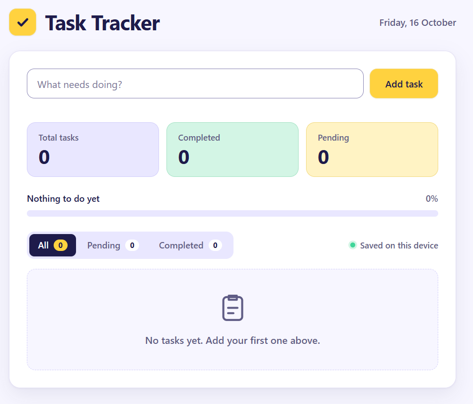
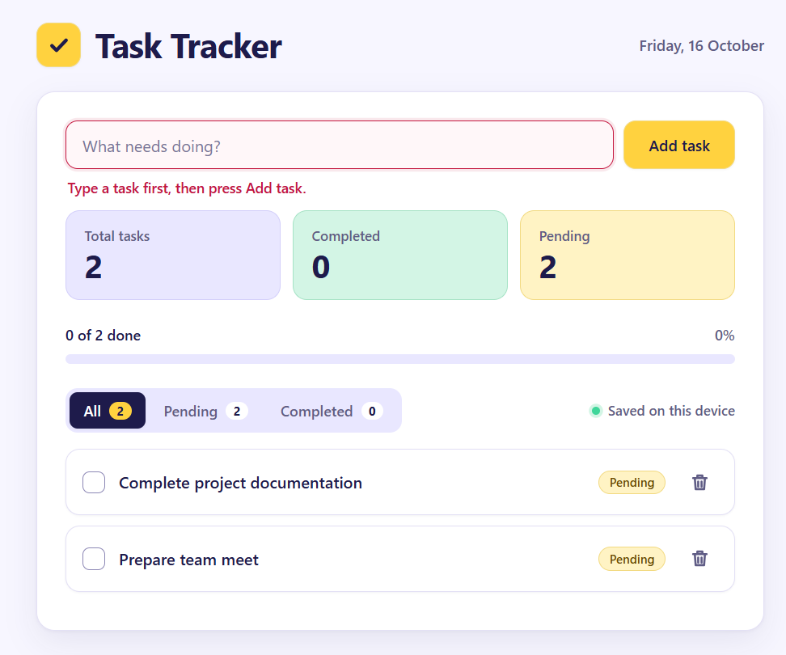
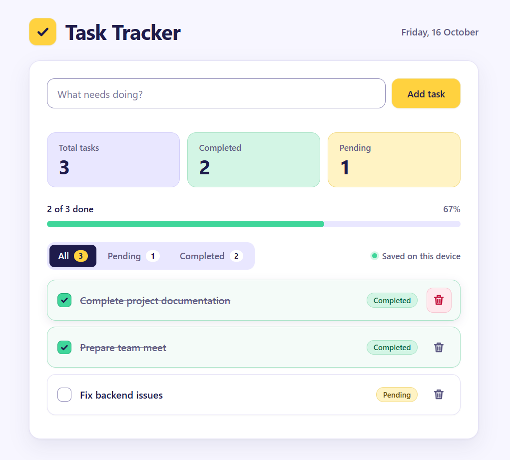
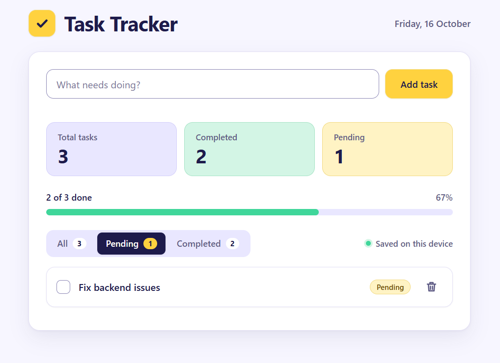
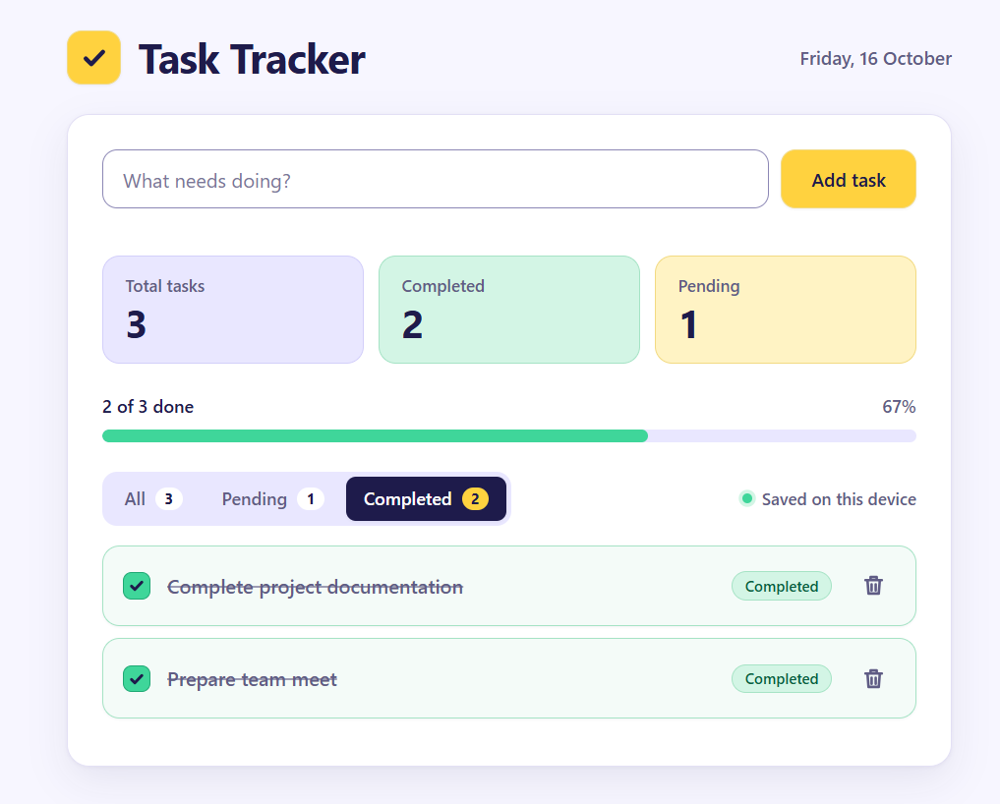
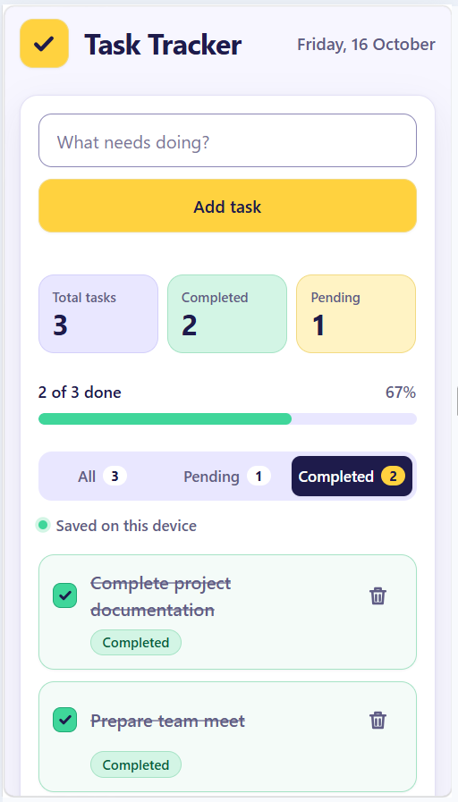
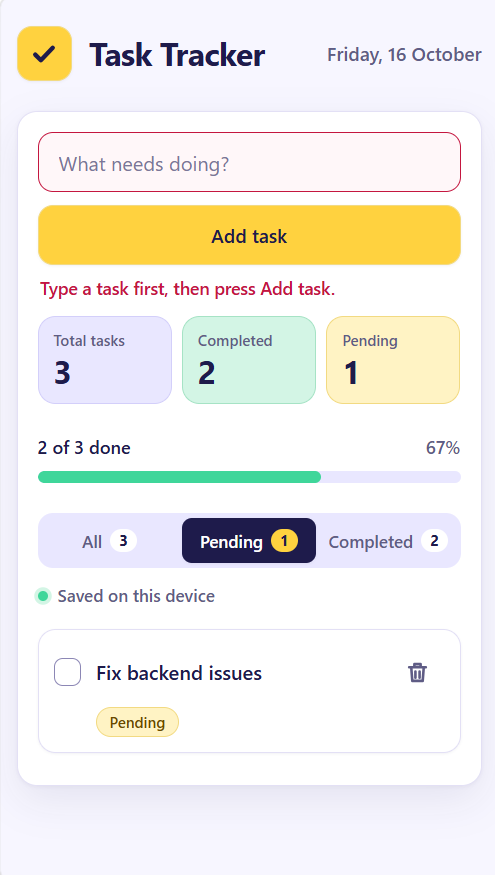

# Task Tracker

A simple Task Tracker web app built for the JTRONIX frontend internship assessment. It is written with plain HTML, CSS and JavaScript. There are no libraries, no build step, and no backend or database.

## Files

| File | Purpose |
| --- | --- |
| `index.html` | Page structure |
| `style.css` | Layout, styling and responsive design |
| `script.js` | App logic and localStorage saving |

## How to run

1. Download or clone the project and keep the three files above in the same folder.
2. Open `index.html` in any modern browser (Chrome, Edge, Firefox or Safari).

That is all. No installation or server is needed.

Tasks are saved in the browser's localStorage under the key `taskTracker.tasks`. To reset the app, delete the tasks in the app or clear the site data for the page in the browser.

---

## Question 1.1: Create and Display Tasks

**What was built**

- A text box and an **Add task** button at the top of the page.
- Clicking **Add task** (or pressing Enter) adds the task to the list on the page.
- Empty tasks are blocked. If the box is empty or only contains spaces, nothing is added and an error message appears under the input.

**Screenshot**

## Question 1.2: Manage Tasks

**What was built**

- Each task has a checkbox to mark it as **Completed** or **Pending**. A badge shows the current status, and completed tasks get a strikethrough.
- Each task has a **Delete** button (trash icon).
- Summary cards show **Total tasks**, **Completed** and **Pending**. A progress bar also shows how many tasks are done, with a percentage.

**Screenshot**

## Question 1.3: Filter and Save Tasks

**What was built**

- **All**, **Pending** and **Completed** filters above the list. The active filter is highlighted, and each one shows a count.
- Tasks and their statuses are saved to localStorage after every change, so they are still there after refreshing the page.
- The layout is responsive. It adapts to desktop, tablet and mobile screens, with no horizontal scrolling.

**Screenshots**

Filters (desktop):

Mobile view:

## Notes

- All features from the three questions are complete.
- No backend or database is used. All data stays in the user's own browser.
- Public deployment: not deployed (optional).
